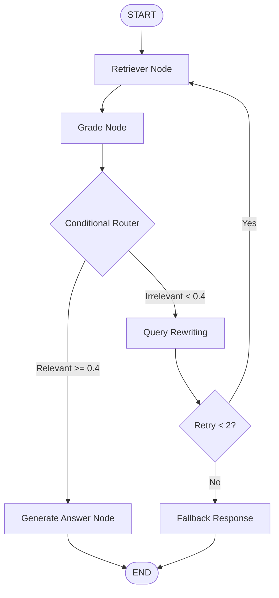

# Niyam AI Chatbot

An AI-powered RAG (Retrieval-Augmented Generation) chatbot built using LangGraph, LangChain, ChromaDB, HuggingFace Embeddings, Groq LLM, and FastAPI.

Niyam AI Chatbot retrieves relevant information from PDF documents, evaluates retrieved context, rewrites queries when necessary, and generates accurate answers with source references.

## 🚀 Project Overview

Niyam AI Chatbot is designed to provide document-based question answering using a RAG architecture.

Instead of generating answers directly from the LLM's pre-trained knowledge, the system retrieves relevant information from uploaded and indexed PDF documents and uses that context to generate grounded answers.

The application also includes:
- Retrieval Relevance Evaluation
- Automatic Query Rewriting
- Conditional Routing using LangGraph
- Maximum 2 Retrieval Retries
- Source Attribution (PDF Name and Page Number)
- Final Answer Evaluation
- FastAPI Backend Integration

---

## 🏗️ Project Architecture

The project consists of two major pipelines:

1. Document Ingestion and Indexing Pipeline
2. Query Processing Pipeline using LangGraph

### 1. Document Ingestion and Indexing Pipeline

This pipeline prepares PDF documents for semantic search.

**Step 1: PDF Document Loading**

- Load PDF documents.
- Extract text content from the documents.
- Preserve document metadata such as PDF filename and page number.

**Step 2: Text Splitting**

- Split extracted text into smaller chunks.
- Maintain chunk overlap to preserve contextual continuity.
- Keep document metadata associated with each chunk.

**Step 3: Embedding Generation**

- Generate vector embeddings for each document chunk.
- Use HuggingFace `all-MiniLM-L6-v2` embedding model.
- Convert textual information into numerical vector representations.

**Step 4: Vector Database Storage**

- Store generated embeddings and corresponding document chunks in ChromaDB.
- Preserve metadata for source attribution.
- Make indexed documents available for semantic retrieval.

### 2. Query Processing Pipeline using LangGraph

The query processing pipeline handles user questions and generates final answers.

**Step 1: User Query**

- Receive the original question from the user.
- Store the original question in GraphState.
- Pass the question to the LangGraph workflow.

**Step 2: Document Retrieval (Retriever Node)**

- Perform semantic similarity search using ChromaDB.
- Use HuggingFace embeddings to convert the query into a vector.
- Retrieve the Top 5 relevant document chunks.
- Calculate retrieval relevance scores.
- Extract document context and preserve source metadata.

**Step 3: Retrieval Relevance Evaluation (Grade Node)**

- Evaluate retrieved documents and context against the original question.
- Analyze semantic relevance and contextual information.
- Consider retrieval scores as supporting information.
- Generate a relevance score between 0.0 and 1.0.
- Use JSON structured output to obtain evaluation results.

**Step 4: Conditional Routing (Router Node)**

LangGraph uses conditional edges to determine the next execution step.

Two possible decisions are generated:

**CASE 1: Relevant Context (Score ≥ 0.4)**

- Accept the retrieved context.
- Preserve the original question.
- Route execution to the Answer Generation Node.

**CASE 2: Irrelevant Context (Score < 0.4)**

- Route execution back to the Retriever Node.
- Rewrite the original question using the LLM.
- Preserve the original question separately.
- Use the rewritten question for the next retrieval attempt.
- Increment the retry counter.

Maximum 2 retrieval retries are allowed. If relevant context is still not found, the system returns a fallback response.

**Step 5: Query Rewriting**

- Analyze the original question and retrieval results.
- Generate an alternative search query.
- Preserve the original intent and meaning.
- Improve search wording and terminology.
- Send the rewritten question back to the Retriever Node.

**Step 6: Answer Generation (Generate Answer Node)**

When relevant context is found:

- Pass the original question, rewritten question, retrieved documents, context, and retrieval scores to the LLM.
- Generate an accurate answer based strictly on retrieved context.
- Avoid unsupported information and hallucinations.
- Identify relevant PDF filenames and page numbers.
- Generate a structured response.

**Step 7: Final Answer Evaluation**

Evaluate the generated answer using three metrics:

1. **Answer Relevance:** Measures how accurately the answer addresses the original question.
2. **Faithfulness:** Measures how much of the generated answer is supported by retrieved context.
3. **Completeness:** Measures whether the answer covers the important relevant information available in the retrieved context.

Generate an overall score based on the answer evaluation.

**Step 8: Final Response**

Return the final response containing:

- Generated Answer
- Source PDF Filename
- Source Page Number
- Overall Score

---

## 🔄 LangGraph Workflow



---

## 🧠 GraphState Management

GraphState is implemented using Pydantic BaseModel and manages information shared between LangGraph nodes.

Important state fields:

| Field | Description |
|---|---|
| original_question | Original user question |
| question | Rewritten question |
| documents | Retrieved document chunks |
| context | Combined retrieved context |
| grades | Retrieval relevance scores |
| relavance_score | Context relevance score |
| decision | Routing decision |
| retry | Number of retrieval retries |
| generated_answer | Final generated answer |
| source | Source PDF information |
| evaluation | Answer evaluation metrics |
| overall_score | Overall answer quality score |

---

## ⚙️ Technology Stack

| Technology | Purpose |
|---|---|
| Python | Core programming language |
| LangChain | LLM and RAG integration |
| LangGraph | Stateful workflow and conditional routing |
| Groq LLM | Query rewriting, evaluation, and answer generation |
| HuggingFace Embeddings | Text embedding generation |
| all-MiniLM-L6-v2 | Embedding model |
| ChromaDB | Vector database |
| Pydantic | Structured data validation |
| FastAPI | Backend API development |
| HTML | Frontend structure |
| CSS | Frontend styling |
| JavaScript | Frontend interactions and API integration |

---

## 📡 FastAPI Integration

FastAPI provides an API endpoint for communication between the frontend and LangGraph workflow.

**Endpoint:**

```http
POST /chat
```

**Request Body:**

```json
{
    "query": "Your question here",
    "thread_id": "abc123"
}
```

**Response:**

```json
{
    "answer": "Generated answer based on retrieved documents.",
    "sources": [
        {
            "pdf_name": "FEMA_Guidelines.pdf",
            "page": 6
        }
    ],
    "overall_score": 0.95
}
```

The frontend communicates with the FastAPI backend using JavaScript Fetch API.

---

## 📂 Project Structure

```text
Niyam-AI-Chatbot/
│
├── app/
│   ├── graph.py
│   ├── node.py
│   ├── state.py
│   └── ...
│
├── data/
│   └── PDF Documents
│
├── frontend/
│   ├── index.html
│   ├── style.css
│   └── script.js
│
├── vectorstore/
│
├── main.py
├── config.yaml
├── requirements.txt
├── .env
└── README.md
```

---

## ▶️ Installation and Execution

**1. Clone the repository**

```bash
git clone <your-repository-url>
```

**2. Navigate to the project directory**

```bash
cd Niyam-AI-Chatbot
```

**3. Create a virtual environment**

```bash
python -m venv venv
```

**4. Activate the virtual environment**

Windows:

```bash
venv\Scripts\activate
```

**5. Install dependencies**

```bash
pip install -r requirements.txt
```

**6. Configure environment variables**

Configure your Groq API key and other required settings.

**7. Run the FastAPI server**

```bash
uvicorn main:app --reload
```

**8. Access API documentation**

```text
http://127.0.0.1:8000/docs
```

**9. Run the frontend**

Open the frontend using your preferred local development server and configure its API URL to point to FastAPI.

---

## ⭐ Key Features

- PDF-based question answering.
- Semantic document retrieval.
- Context relevance evaluation.
- Automatic query rewriting.
- Conditional workflow execution using LangGraph.
- Maximum 2 retrieval retries.
- Structured JSON output.
- Source attribution with PDF filename and page number.
- Final answer quality evaluation.
- FastAPI backend integration.
- Separate HTML, CSS, and JavaScript frontend.

---

## 🎯 Project Objective

The main objective of Niyam AI Chatbot is to build a reliable document-based AI assistant that can retrieve relevant information, evaluate retrieval quality, improve search queries when necessary, and generate context-grounded answers with source references.

The project combines Retrieval-Augmented Generation (RAG), semantic search, LLM-based evaluation, and stateful workflow orchestration to improve the reliability of document-based question answering.
