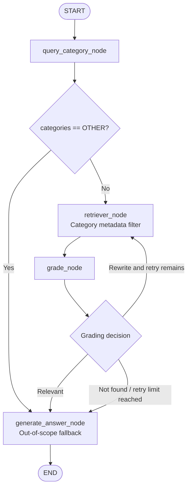

# Niyam AI Chatbot

A document-grounded question-answering chatbot for RBI / FEMA guidelines. The application uses Retrieval-Augmented Generation (RAG), LangChain, LangGraph, ChromaDB, HuggingFace embeddings, a Groq LLM, and FastAPI.

The workflow first classifies the user's query into one or more PDF categories. It then retrieves chunks only from the matching category or categories, evaluates the retrieved context, rewrites the query when needed, and generates a response with source information. Queries classified as `OTHER` bypass retrieval and go directly to the answer node for an out-of-scope response.

## Project overview

Niyam AI is designed to answer questions using the seven indexed RBI/FEMA PDF documents in the project's PDF knowledge base. It should not use general model knowledge as a substitute when the documents do not support an answer.

### Main capabilities

- PDF ingestion, text chunking, embeddings, and persistent ChromaDB storage.
- Page-level metadata carried into chunks, including `source`, `page`, and `category`.
- LLM-based query-to-category classification.
- Support for one or multiple matching categories.
- `OTHER` classification for queries outside the supported document categories.
- Metadata-filtered semantic retrieval using ChromaDB.
- Retrieval relevance scoring and LLM-based context grading.
- Query rewriting and a bounded retrieval retry loop.
- PDF-grounded answer generation with source attribution.
- Final answer evaluation for relevance, faithfulness, and completeness.
- FastAPI backend and HTML/CSS/JavaScript frontend.

---

## Architecture

The application has two main pipelines:

1. One-time PDF ingestion and vector indexing.
2. Per-query classification, filtered retrieval, grading, and answer generation through LangGraph.

### 1. Document ingestion and indexing

1. **Load PDFs** — load the seven source PDFs and extract page text.
2. **Attach metadata** — assign each page its PDF `source`, page number, and matching `category`.
3. **Split documents** — split pages into overlapping chunks; the chunks retain their source metadata.
4. **Generate embeddings** — create vector embeddings using HuggingFace `all-MiniLM-L6-v2`.
5. **Persist vectors** — store chunk text, embeddings, and metadata in ChromaDB.

Each chunk should carry metadata similar to:

```python
{
    "source": "Insurance.pdf",
    "page": 2,
    "category": "Insurance"
}
```

The category value must match the category strings used by the category-classification node and the metadata filter. If the category metadata is added or changed, rebuild the existing vector database so the stored chunks contain the new metadata.

### 2. Query processing with LangGraph

#### Step 1 — Receive the question

FastAPI receives the user's question through `POST /chat` and starts the compiled LangGraph workflow. The original question is stored in `GraphState`.

#### Step 2 — Query category node

`query_category_node` sends the original question and the supported category list to the LLM.

- The LLM returns a list in `categories`.
- One matching category is returned as a one-item list.
- Multiple matching categories can be returned together.
- If none of the supported categories applies, the LLM returns `["OTHER"]`.
- The node also returns `original_question` so the structured output satisfies the current `GraphState` schema.

Supported category values:

- `Compounding_of_Contraventions_under_FEMA`
- `Deposits_and_Accounts`
- `External_Commercial_Borrowings_Trade_Credits_and_Structured_Obligations`
- `Foreign_Investment_in_India`
- `Insurance`
- `Money_Transfer_Service_Scheme`
- `Overseas_Investment`

#### Step 3 — Route after category classification

`router_after_query_node` checks `state.categories`.

- If `categories == ["OTHER"]`, route directly to `generate_answer_node`. Retrieval is skipped.
- Otherwise, route to `retriever_node`.

The answer node handles the `OTHER` case and returns the configured out-of-scope response.

#### Step 4 — Filtered retrieval

`retriever_node` selects the original question on the first attempt and the rewritten question on subsequent attempts.

It calls ChromaDB `similarity_search_with_relevance_scores()` with the configured `top_k` and a metadata filter based on the category list, conceptually:

```python
filter={
    "category": {
        "$in": state.categories
    }
}
```

This limits semantic similarity search to chunks whose `category` matches one of the classified categories. The node stores retrieved documents, their relevance scores, and the combined context in `GraphState`.

#### Step 5 — Grade retrieved context

`grade_node` evaluates whether the retrieved documents and context support the user's question. It uses the retrieval scores as supporting information and obtains a structured grading result from the LLM.

The grading result determines the next route:

- **Relevant** — proceed to `generate_answer_node`.
- **Rewrite** — if retry attempts remain, store the rewritten question, increment the retry counter, and return to `retriever_node`.
- **Not found / other non-relevant outcome** — proceed to `generate_answer_node`, where the fallback is returned rather than generating an unsupported answer.

The current node logic allows up to two retries. Keep the retry limit aligned with the implementation in `grade_node`.

#### Step 6 — Generate answer or fallback

`generate_answer_node` handles three outcomes:

1. **`categories == ["OTHER"]`** — return an out-of-scope message explaining that Niyam AI answers questions related to its available RBI/FEMA guideline documents.
2. **Decision is `not_found`** — return a no-relevant-information response because the available documents did not provide sufficient support.
3. **Relevant context** — generate an answer grounded in the retrieved context and include the available source PDF/page information.

The `OTHER` case and the `not_found` case are different: a query can belong to a supported category while the specific answer is absent from the PDFs.

#### Step 7 — Evaluate the generated answer

For a generated answer, the LLM evaluates:

- **Answer relevance** — whether the answer addresses the user's question.
- **Faithfulness** — whether the answer is supported by retrieved context.
- **Completeness** — whether the answer covers the relevant information available in the context.

Python calculates the overall score as the average of these three evaluation scores.

#### Step 8 — Return the response

FastAPI returns the configured response fields to the frontend, such as the generated answer, source details, and overall evaluation score.

---

## LangGraph workflow



### Routing summary

| Stage | Condition | Next node |
|---|---|---|
| Category router | `categories == ["OTHER"]` | `generate_answer_node` |
| Category router | One or more supported categories | `retriever_node` |
| Grade router | `relevant` | `generate_answer_node` |
| Grade router | `rewrite` and retry remains | `retriever_node` |
| Grade router | `not_found` or retry limit reached | `generate_answer_node` |

---

## GraphState

`GraphState` is the shared state model used by the LangGraph nodes. The workflow uses fields such as:

| Field | Purpose |
|---|---|
| `original_question` | Original user query |
| `question` | Rewritten query used for a retry |
| `categories` | One or more classified PDF categories, or `["OTHER"]` |
| `documents` | Retrieved LangChain documents |
| `context` | Combined retrieved chunk text |
| `grades` | Chroma retrieval relevance scores |
| `relavance_score` | LLM context relevance score (retain the spelling used by the code) |
| `decision` | Grading / routing decision |
| `retry` | Number of retrieval retries |
| `generated_answer` | Final answer or fallback |
| `source` | Source PDF and page information |
| `evaluation` | Answer relevance, faithfulness, and completeness |
| `overall_score` | Average answer evaluation score |

The category-classification call currently uses `GraphState` as its structured-output schema. Therefore, its JSON output must include every required field in that schema; in particular, it must return `original_question` as well as `categories`. Alternatively, a dedicated smaller Pydantic schema can be used for category classification.

---

## Technology stack

| Technology | Role |
|---|---|
| Python | Application logic |
| LangChain | LLM, prompt, document, and retrieval integration |
| LangGraph | Stateful workflow and conditional routing |
| Groq LLM | Category classification, grading, rewriting, and answer generation |
| HuggingFace Embeddings | Converts text into vectors |
| `all-MiniLM-L6-v2` | Embedding model |
| ChromaDB | Persistent vector database and metadata-filtered retrieval |
| Pydantic | Structured output and state validation |
| FastAPI | Backend API |
| HTML, CSS, JavaScript | Browser frontend |

---

## API integration

**Endpoint**

```http
POST /chat
```

The exact request and response schema is defined by the FastAPI implementation in `main.py`. A typical request may contain a query and a conversation/thread identifier, depending on the current API code.

---

## Project structure

```text
Niyam-AI-Chatbot/
├── app/
│   ├── graph.py
│   ├── node.py
│   ├── route.py
│   ├── state.py
│   ├── prompt.py
│   └── graph_visualization.py
├── config/
│   ├── __init__.py
│   └── config.yaml
├── data/
│   ├── Graph/
│   │   └── graph.png
│   └── PDF_Documents/
│       └── (7 RBI/FEMA PDFs)
├── chromadb/
├── LogHandler/
│   ├── custom_exception.py
│   ├── logger.py
│   └── test.py
├── scripts/
│   └── ingest.py
├── template/
│   ├── index.html
│   ├── style.css
│   └── script.js
├── main.py
├── requirements.txt
├── setup.py
├── Dockerfile
├── README.md
└── .gitignore
```

### Main module responsibilities

| Path | Responsibility |
|---|---|
| `app/graph.py` | Defines nodes, edges, conditional routing, and compiles the LangGraph workflow. |
| `app/node.py` | Implements category classification, filtered retrieval, grading, query rewriting, and answer generation. |
| `app/route.py` | Implements routing after category classification and after grading. |
| `app/state.py` | Defines `GraphState` and structured state fields. |
| `app/prompt.py` | Stores category, grading, rewriting, and answer-generation prompts. |
| `scripts/ingest.py` | Loads PDFs, attaches metadata, chunks documents, creates embeddings, and persists ChromaDB. |
| `config/config.yaml` | Stores paths and configurable ingestion / retrieval / model settings. |
| `main.py` | Exposes the FastAPI endpoint and invokes the graph. |
| `template/` | Contains the HTML, CSS, and JavaScript frontend. |
| `LogHandler/` | Contains logging and custom exception utilities. |
| `app/graph_visualization.py` | Supports workflow graph visualization. |

---

## Installation and execution

1. Clone the repository and move into the project directory.
2. Create and activate a Python virtual environment.
3. Install dependencies from `requirements.txt`.
4. Configure the required API key and application settings in environment variables / configuration files.
5. Place the seven supported PDF files in the configured PDF directory.
6. Run the ingestion script to create the ChromaDB collection with `source`, `page`, and `category` metadata.
7. Start the FastAPI application using the command configured for the project, for example:

```bash
uvicorn main:app --reload
```

8. Open the frontend and send a test question.

**Important:** if you change the metadata structure or category labels, recreate the vector database. A pre-existing Chroma collection will not automatically gain metadata that was not stored during ingestion.

---

## Knowledge boundary and fallback behavior

Niyam AI is intended to answer from its seven configured RBI/FEMA PDFs only.

- A query outside those PDF topics should be classified as `["OTHER"]` and bypass retrieval.
- A query within a supported topic may still return `not_found` if the relevant answer is not present in the retrieved document context.
- The chatbot should not invent a regulatory answer or silently rely on general LLM knowledge when the source documents do not support it.

## Security

- Keep API keys and `.env` files out of source control.
- Do not commit the local virtual environment.
- Treat the ChromaDB directory as generated application data; include it in version control only if intentionally required.
